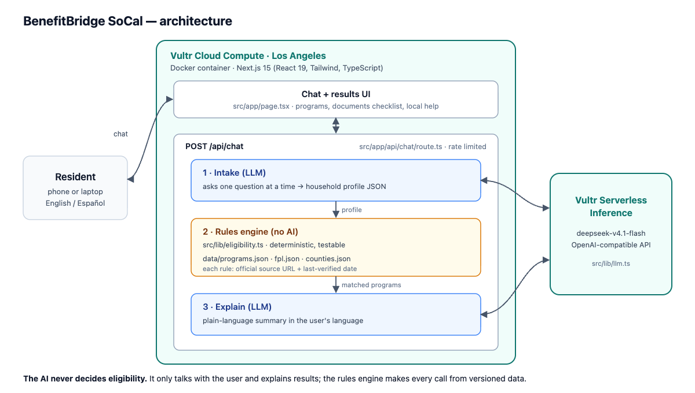

# BenefitBridge SoCal

**Find public benefits your family may qualify for in five minutes, in English or Spanish.**

Many families in Southern California qualify for help with food, health care, utility bills, child care and tax credits but never apply. Program rules are confusing, information is scattered across state, county and utility websites, and language is a barrier. BenefitBridge lets someone describe their situation in plain language. It returns the programs they likely qualify for, the documents to bring, and local help in their county.

Covers **Los Angeles, Orange, Riverside and San Bernardino** counties. Built for **HackGlobal 2026** (Civic and real-world impact track).

## How it works



```
 User (phone or laptop, EN/ES)
        │  chat
        ▼
 Next.js app on a Vultr Cloud Compute instance (Docker)
        │
        ├─► 1. Intake: LLM on Vultr Serverless Inference
        │      asks one simple question at a time, then outputs a
        │      structured household profile (county, size, income, ages, pregnancy)
        │
        ├─► 2. Rules engine (plain TypeScript, no AI)
        │      checks the profile against data/programs.json + data/fpl.json
        │      → matched programs, the reason for each, documents to bring
        │
        └─► 3. Explain: LLM on Vultr Serverless Inference
               turns the results into a short, plain-language summary
               in the user's language (it can't add or change programs)
```

**The AI never decides eligibility.** It only talks with the user and explains results. A deterministic rules engine (`src/lib/eligibility.ts`) makes every eligibility call from versioned data files. Each rule stores its official source URL and the date it was last checked, so results are accurate, testable and transparent.

## Programs covered

| Program | What it is | Rule used |
|---|---|---|
| CalFresh | Grocery money (EBT) | Gross income ≤ 200% FPL |
| Medi-Cal | Health coverage | Adults ≤ 138% FPL, children ≤ 266%, pregnancy ≤ 213% |
| WIC | Food for pregnancy & kids under 5 | ≤ 185% FPL, or on Medi-Cal/CalFresh |
| CARE | 32.5% off SCE electric + gas discount | Annual income ≤ 200% FPL |
| FERA | 18% off SCE electric | 200–250% FPL |
| California LifeLine | Discounted phone service | Enrolled in CalFresh or Medi-Cal |
| Free school meals | Breakfast + lunch at public schools | Any child aged 5–18 (California Universal Meals) |
| Head Start / Early Head Start | Free preschool for kids under 5 | ≤ 100% FPL, or on CalFresh |
| CalEITC | California tax credit, up to $3,756 | Work income ≤ $32,900 (tax year 2025) |
| Federal EITC | IRS tax credit, up to $8,046 | Work income under the IRS limit for the number of children (tax year 2025) |

Poverty line: 2026 HHS guidelines ($15,960 for one person + $5,680 per additional person). Sources and dates are listed in `data/programs.json` and `data/fpl.json`.

**Adding a region = adding an entry to `data/counties.json`.**

## Run it locally

```bash
npm install
cp .env.example .env.local   # add your Vultr Serverless Inference key
npm run dev                  # http://localhost:3000
```

`.env.local`:

```
LLM_PROVIDER=vultr
VULTR_INFERENCE_API_KEY=your-key
VULTR_INFERENCE_MODEL=deepseek-v4.1-flash-1017
```

Any OpenAI-compatible endpoint works via `VULTR_INFERENCE_BASE_URL`. Claude is also supported (`LLM_PROVIDER=anthropic`).

## Deploy on Vultr

On a Vultr Cloud Compute instance (Ubuntu LTS, 2 GB RAM):

```bash
git clone https://github.com/rawmoz/benefitbridge.git && cd benefitbridge
nano .env            # same variables as .env.local
bash deploy.sh       # installs Docker, builds the image, serves on port 80
```

## How we used Vultr

- **Vultr Cloud Compute** (Los Angeles, shared CPU) hosts the Next.js app in a Docker container.
- **Vultr Serverless Inference** runs the LLM for the intake conversation and the plain-language explanation of results.

## Project structure

```
data/                 programs, poverty line, county resources (JSON, versioned)
src/lib/eligibility.ts  rules engine
src/lib/llm.ts          LLM client (Vultr Serverless Inference / OpenAI-compatible, or Claude)
src/app/api/chat/       intake → profile → rules engine → explanation
src/app/page.tsx        chat + results UI (EN/ES)
Dockerfile, deploy.sh   Vultr deployment
```

## Disclaimer

BenefitBridge gives estimates based on official income limits. It is not an application and not a decision; the agency makes the final determination.

## Credits

Built with [Next.js](https://nextjs.org), [React](https://react.dev), [Tailwind CSS](https://tailwindcss.com), the [Anthropic SDK](https://github.com/anthropics/anthropic-sdk-typescript), [Vultr](https://www.vultr.com) Cloud Compute and Serverless Inference. AI coding tools were used during development. Program rules come from CDSS, DHCS, USDA (WIC), CPUC, HHS, the California Department of Education, the Office of Head Start, the Franchise Tax Board and the IRS. County resources come from official county, food bank and legal aid sites.
